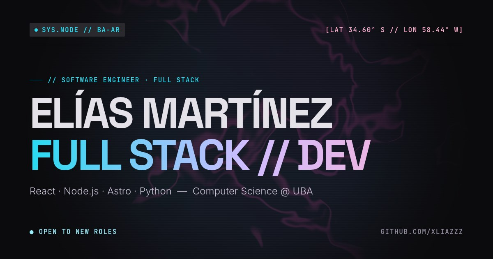

# Elías Martínez · Software Engineer · Full Stack



Portfolio personal y CV online. Muestra mi experiencia, stack y proyectos, con descarga del CV en español o inglés.

**Sitio:** [portfolio-v2-rust-kappa.vercel.app](https://portfolio-v2-rust-kappa.vercel.app/)

---

## Qué tiene

- **Diseño "Neon Future"** creado en Google Stitch e implementado con tokens de Tailwind v4: tipografía Space Grotesk / Inter / JetBrains Mono, paneles de vidrio, bordes finos y acentos cian, violeta y magenta.
- **Fondo WebGL**: shader procedural que reproduce la vista de página completa de Stitch. Queda oscuro en el hero y en contacto, y se ilumina en la zona del stack y la experiencia.
- **Esfera 3D interactiva** (canvas 2D con proyección en perspectiva, sin librerías): una esfera geodésica cuyos nodos principales son mi stack, agrupado en tres planos (frontend, backend y sistemas/IA) con sus órbitas. Se arrastra para rotarla y se ilumina con el cursor.
- **Español / inglés**: detecta el idioma del navegador en la primera visita y recuerda la elección manual. El texto, los placeholders, los mensajes del formulario y el link del CV cambian juntos.
- **Descarga del CV** en el idioma activo (`public/cv/`).
- **Formulario de contacto** con EmailJS y validación en ambos idiomas.
- **SEO**: JSON-LD (`Person`, `WebSite`, `ItemList` de proyectos), Open Graph, sitemap y robots.
- **Accesibilidad**: navegación por teclado, link para saltar al contenido, estados `aria-current` / `aria-pressed` y respeto de `prefers-reduced-motion` (el fondo y la esfera quedan quietos).

Lighthouse (laboratorio): **Performance 98 en desktop y 88 en mobile**, con Accesibilidad, Buenas prácticas y SEO en 100.

---

## Stack

| | |
| --- | --- |
| Framework | [Astro 5](https://astro.build) (sitio estático) |
| Estilos | [Tailwind CSS 4](https://tailwindcss.com) (`@theme` en `src/styles/global.css`) |
| Gráficos | WebGL (fondo) y Canvas 2D (esfera), sin dependencias |
| Contacto | [EmailJS](https://www.emailjs.com) + SweetAlert2 |
| Imágenes | Cloudinary (redimensionadas por URL) |
| Deploy | Vercel |

---

## Correr el proyecto

Requisitos: Node 20+ y pnpm.

```bash
pnpm install
pnpm dev       # http://localhost:4321
pnpm build     # genera dist/
pnpm preview   # sirve dist/
```

El formulario necesita las credenciales de EmailJS en un `.env` en la raíz. En Vercel, cargalas en **Settings → Environment Variables**, tanto para *Production* como para *Preview*:

```bash
PUBLIC_SERVICEID=service_xxxxxxx
PUBLIC_TEMPLATEID=template_xxxxxxx
PUBLIC_KEY=xxxxxxxxxxxxxxx
```

El template de EmailJS recibe `{{user_name}}`, `{{user_email}}`, `{{company}}` y `{{message}}`.

---

## Dónde editar el contenido

| Qué | Archivo |
| --- | --- |
| Proyectos (`featured` = tarjeta grande, `bootcamp` = etiqueta) | `src/data/projectsCard.json` |
| Email, teléfono, ubicación y redes | `src/data/contactAndSocial.json` |
| Tecnologías del marquee | `src/data/stackData.ts` |
| Clusters del stack | `src/sections/SkillsSection.astro` |
| Experiencia y formación | `src/sections/ExperienceSection.astro` |
| Tecnologías de la esfera 3D | `src/components/base/NodeSphere.astro` |
| CV en PDF (ES / EN) | `public/cv/` |

Los textos en inglés viven junto al español, en el atributo `data-en` de cada elemento.

## Estructura

```
src/
├── pages/        index y 404
├── layouts/      <head>, SEO, fondo y motor de idioma
├── sections/     hero, perfil, stack, experiencia, proyectos, contacto, footer
├── components/   base (nav, sección, íconos, shader, esfera, link al CV) y formulario
├── data/         contenido en JSON / TS
└── styles/       tokens del diseño
public/
├── cv/           CV en español e inglés
└── utils/        envío del formulario y avisos
```

---

## Licencia

MIT. Podés usar el código como referencia o inspiración manteniendo la atribución.

## Contacto

- **LinkedIn:** [linkedin.com/in/eliasm166](https://www.linkedin.com/in/eliasm166/)
- **GitHub:** [github.com/XliazZz](https://github.com/XliazZz)
- **Email:** [eliasdev1912@gmail.com](mailto:eliasdev1912@gmail.com)
- **WhatsApp:** [+54 11 4888-4304](https://wa.me/5491148884304)
